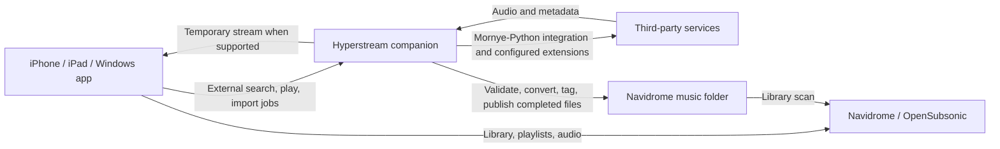

# Navidrome Hyperstream: draft roadmap

Status: server import prototype and first Flutter client slice; feasibility validation ongoing.
Updated: November 10, 2026.

## Product direction

An iPhone-first music app that plays a personal Navidrome library and can search,
stream, and import music through replaceable third-party providers. Navidrome is
the permanent library. A companion service performs provider downloads on the
server, independently of whether the phone app is open.

Confirmed decisions:

- Platform priority: iOS, then iPadOS, then Windows.
- Distribution: personal use and sideloading first; consider the App Store later.
- Third-party downloads go to the Navidrome server only.
- Navidrome currently runs in Docker on the user's Windows PC.
- The user primarily works in TypeScript and has no local Mac; GitHub Actions now builds iOS releases.
- Language familiarity is not a constraint: Swift/native development, Flutter,
  and later ports are acceptable. Reliability and understandable, manually
  editable code are the main implementation priorities.
- Mornye was referenced for its SpotiFLAC lineage and provider/download ecosystem.
  Follow that ecosystem for acquisition and provider selection.
- Library output: MP3 at 320 kbps. Discard the downloaded FLAC source after the
  converted file passes validation and is safely published to the library.
  Original files may remain temporarily for recovery from a failed import.
- Flutter is selected for the first shared-client prototype. The final decision
  depends on native playback validation, especially on a real iPhone. SwiftUI
  remains the Apple-first alternative if a separate Windows client is acceptable.
- GitHub Actions is selected for hosted macOS builds. Begin with manually
  triggered unsigned release IPAs and local signing through AltStore Classic/
  AltServer on Windows. Hosted compilation and packaging are verified; device
  installation and basic playback are confirmed by the user.
- Independent app volume, optional iOS audio mixing, and an Apple Music-inspired
  interface with saved light/dark/system appearance are part of the client.

Proposed MVP boundaries:

- One user, one Navidrome server, and a plugin-based acquisition backend. Validate
  a representative metadata/download provider combination first, then expand the
  tested compatibility list without hardcoding the client to those services.
- Direct native audio playback from Navidrome through OpenSubsonic.
- Search and playback of external music where the selected provider supports it.
- Explicit "Add to library" action for permanent server imports.
- No device download feature in the initial MVP. Transient playback buffering is
  separate from permanent downloads. Optional offline copies of Navidrome music
  can be discussed later.

## Proposed architecture

The app connects directly to Navidrome for normal library use. An unavailable
companion must not prevent existing library playback. Provider credentials and
download jobs belong on the companion. The client stores its own server account
in iOS Keychain or Windows DPAPI-protected storage and restores the connection
on launch. Temporary network failures keep the saved account; explicit disconnect
removes it. A session-only sign-in option is also available.

Deploy the companion alongside Navidrome in Docker on the Windows PC. Bind-mount
the intended host library folder into the import worker, and keep downloads and
conversion staging outside Navidrome's scanned folders. Docker Desktop supports
sharing host paths into its containers; verify actual paths and permissions during
setup. See [Docker bind mounts](https://docs.docker.com/engine/storage/bind-mounts/).

The supported OpenSubsonic endpoint
inventory includes playback and scanning, but no general file-upload endpoint;
we will implement imports through the filesystem rather than assume an upload
API exists. See [Navidrome API compatibility](https://www.navidrome.org/docs/developers/subsonic-api/).

External streaming and importing are separate capabilities. Playing a result
must not silently add it to the permanent library. The provider feasibility
check must establish whether seeking, URL renewal, and progressive playback work.
A provider that only supports completed downloads must expose that limitation.

## Mornye integration: use the acquisition ecosystem

The acquisition backend is the relevant reference. Reusing or forking the mobile
player is not a product requirement. The mobile project's extension registry
distinguishes metadata providers from audio download providers; a Spotify link
can identify a recording without Spotify being the source of its audio. Preserve
both the requested recording and the actual audio source in our import records.
See the [Mornye extension registry](https://github.com/mornyeapp/Mornye-Extension/blob/main/registry.json).

The preferred feasibility candidate is
[Mornye-Python](https://github.com/mornyeapp/Mornye-Python). It documents headless
Docker operation, Python integration, and configurable JavaScript/Python
extensions. It ships without a provider or default registry. This is a separate
project: validate compatibility with chosen ecosystem extensions rather than
assume that it shares the mobile app's implementation or supports every plugin.

Its documented `/api/v1` exposes link resolution, search, download jobs, history,
and installed extensions. Integrate against that contract where suitable. The
REST documentation does not establish a pre-import audio-stream endpoint and
deliberately omits server file paths from download results. A server-side SDK
integration or verified completion hook/artifact handoff must connect acquisition
to conversion and publication. Do not infer completion from a file appearing in
a download directory. See the
[REST API guide](https://github.com/mornyeapp/Mornye-Python/blob/main/docs/guide/rest-api.md).

The [automation guide](https://github.com/mornyeapp/Mornye-Python/blob/main/docs/guide/automation.md)
documents typed post-download hooks carrying a result and file path, plus
Navidrome rescan support. Test these as the preferred handoff mechanism. Hook
errors are documented as logged and skipped, so upstream download success must
not mark our import complete when conversion or publication fails. Persist and
reconcile our import state independently.

Pin a tested backend version and extension versions. Keep the app-facing API
independent of provider internals. Check existing conversion and job capabilities
before adding our own; Hyperstream should supply only the missing orchestration
and Navidrome integration. The initial proof must exercise process restart and
repeated completion events, regardless of upstream persistence claims.

## Acquisition and conversion pipeline

Proposed order: resolve a link/search result, match the recording, acquire source
audio, validate, convert using the user's profile, preserve tags/artwork, publish
the final file, then reconcile with Navidrome.

- Prefer a lossless source when available. Convert to MP3 at 320 kbps for the
  library; retain source files only until validation and publication succeed.
- The [Python API reference](https://github.com/mornyeapp/Mornye-Python/blob/main/docs/guide/api-reference.md)
  documents conversion settings for several lossless formats and MP3, bitrate,
  and original retention. Evaluate `transcode_to="mp3"` and
  `transcode_bitrate="320k"`. Use temporary source retention in staging until our
  validation and publication complete, then remove the source. This is an import
  recovery measure, not permanent FLAC archival. Verify upstream conversion and
  hook ordering before relying on its cleanup behavior.
- Record the actual source format and output format. Do not label a converted
  lossy source as lossless or silently substitute a different recording.
- Keep an immutable conversion-profile snapshot per job, so a settings change
  does not unexpectedly change an in-progress import or retry.
- Validate output duration, decodability, tags, artwork, and track/disc ordering
  before publication. Treat conversion failures as recoverable import failures.
- Discard FLAC after successful validation and publication. If either fails,
  retain the staged source for retry; retry cleanup separately if publication
  succeeds but source removal fails. Never delete existing library tracks as
  part of source cleanup.
- Prototype against a disposable library, then configure the real Windows host
  paths. Nothing should alter existing library files as part of the prototype.

## Client framework decision

Choose for maintainability across the requested platforms, rather than language
familiarity alone. The recommendation is provisional until playback validation:

| Candidate | Main advantage for this project | Maintenance tradeoff |
| --- | --- | --- |
| Flutter/Dart | Share UI and application logic across iPhone, iPad, and Windows with one framework. | Native audio and system controls still depend on platform implementations; learn Dart and Flutter layout/state conventions. |
| Swift/SwiftUI | Direct access to Apple frameworks and native Apple interface behavior. | Windows needs its own UI/application implementation; iOS development needs a practical macOS workflow. |
| React Native/TypeScript | Existing language familiarity and shared React Native components. | Windows has a separate native host and dependency support matrix; mobile modules cannot be assumed portable. |

Flutter is the leading candidate for maintaining one client across all three
targets. SwiftUI is the preferred alternative if optimizing Apple integration is
worth maintaining a separate Windows client later. React Native remains viable,
but TypeScript familiarity alone is not a reason to select it.

Flutter shares rendered widgets and Dart application code across platforms and
can call native implementations when necessary. It does not automatically use
the system's SwiftUI controls. See the
[Flutter architecture](https://docs.flutter.dev/resources/architectural-overview)
and [native integration](https://docs.flutter.dev/platform-integration/platform-channels).
SwiftUI supplies Apple's declarative UI framework across Apple platforms; a
Windows client would be a separate implementation. See
[SwiftUI](https://developer.apple.com/swiftui/).

For a Flutter playback spike, evaluate `just_audio` with `audio_service` on iOS.
Their documentation covers audio queues, background playback, and system controls.
Windows playback needs an additional implementation, and `audio_service` does
not document built-in Windows support. Validate both playback and Windows media
controls before selecting the final dependencies. See
[just_audio](https://pub.dev/packages/just_audio) and
[audio_service](https://pub.dev/packages/audio_service).

Playback must outlive screen/widget lifetime. Keep one application-level playback
service with a small interface for queue commands, play/pause, seeking, and state
events. The selected engine must prove track transitions while backgrounded,
interruption recovery, and system controls on a real phone. Gapless playback is
a separate acceptance check, not an assumption based on a package feature list.

Keep the client straightforward to edit manually:

- Organize code by feature: library, search, player, imports, and settings.
- Keep each screen's presentation and state logic close together, in small files.
- Use plain models and explicit constructor dependencies with a consistent state
  convention. Avoid adding packages or generated layers without a concrete need.
- Isolate Navidrome HTTP calls, companion HTTP calls, and native playback so a
  change to one integration does not spread through every screen.
- Extract shared code when multiple features actually need it. Start with one
  client app rather than a large collection of workspace packages.
- Document where to change common behavior, such as album layout, queue policy,
  server settings, and the import conversion profile.

Python remains behind the companion's documented HTTP/OpenAPI contract, regardless
of client language. Navidrome is directly accessible through the client's
OpenSubsonic service, independently of acquisition. The existing Python prototype
does not commit the client to any framework.

The user has no Mac. GitHub Actions is the selected macOS build environment; the
initial workflow creates an unsigned release IPA for local signing and sideloading
from Windows. This supports phone testing without a local Mac, while interactive
native debugging remains less convenient. Hosted compilation and IPA packaging
are verified. See the [build guide](docs/ios-github-actions.md) and
[Flutter iOS setup](https://docs.flutter.dev/platform-integration/ios/setup).

## Milestones and completion criteria

| Milestone | Scope | Complete when |
| --- | --- | --- |
| 0. Feasibility and product decisions | Validate Mornye-Python in Docker, a metadata/download extension combination, MP3 320 kbps conversion and source cleanup, client framework, iOS build access, and server import destination. | A real Navidrome track plays while the phone is locked; one external track resolves, downloads, converts to MP3 at 320 kbps, and appears in a disposable Navidrome library with its staged FLAC removed after validation/publication; pre-import streaming and completion handoff behavior are documented. |
| 1. iPhone library player | Sign-in, artists/albums/tracks, search, artwork, queue, seek, shuffle/repeat, playlists, favorites, lock-screen controls, and queue restoration. | The app supports a normal listening session and recovers sensibly from network loss, interruptions, and relaunch. Test FLAC, MP3, and AAC files and any chosen transcoding fallback. |
| 2. Server acquisition | Authenticated companion, configured provider plugins, external search, supported external streaming, import jobs, conversion profiles, metadata, collision handling, and Navidrome reconciliation. | An import requested from the phone finishes after the app closes, appears in the chosen library format, becomes playable through Navidrome, and survives a server worker restart without publishing partial files or creating duplicate imports. |
| 3. Personal iPhone release | Playback reliability, useful failures, accessibility, storage limits, source/quality labels, sideload build instructions, and companion deployment instructions. | A repeatable signed build runs on the user's phone and handles representative home and mobile-network listening sessions. |
| 4. iPad experience | Sidebar navigation, simultaneous library/player/queue views, resizing, keyboard shortcuts, and pointer behavior. | The same library and provider workflows work in tablet layouts and narrow multitasking windows. |
| 5. Windows release | Desktop layout, native audio integration, media keys/system transport controls, keyboard use, packaging, and installation. | A packaged Windows build connects to the same services and completes playback and import workflows. |
| 6. App Store assessment | Review enabled providers, distribution rights, privacy disclosures, dependencies, platform requirements, and release configuration. | The intended feature set has a defensible submission path and the release is ready for review; approval is not assumed. |

Milestones describe delivery order, not calendar estimates. Estimate the work
after milestone 0 establishes the difficult integrations.

## First usable experience

Start with Library, Search, Imports, and Settings, with a persistent mini-player
and a full Now Playing view. Search identifies whether a result is already in
Navidrome or comes from an external service. External results expose Play when
supported and Add to library for a permanent import. Imports show progress and
specific recoverable errors.

An import progresses through queued, resolving, downloading, converting,
validating/tagging, publishing, waiting for Navidrome, and ready states. Failed and canceled are
separate states. A successful transfer is not "ready" until the corresponding
Navidrome track is discoverable.

Implementation requirements:

- Persist jobs and idempotency keys so retries and reconnects do not repeat imports.
- Stage downloads outside the scanned library. Publish validated files using a
  non-overwriting finalization step; account for cross-filesystem transfers.
- Check provider IDs, recording identifiers, duration, and release information
  when matching music. Do not silently replace a track with a different version.
- Use an incremental scan or the configured scanner behavior, then reconcile
  imported files with Navidrome IDs. Keep scan credentials on the server when
  needed, and avoid a full-library scan for every individual track.
- Keep provider tokens out of client-visible URLs and logs. Restrict provider
  network/file access and authenticate companion requests.
- Distinguish retryable network failures from missing tracks, authentication
  problems, unsupported capabilities, and unavailable quality levels.

## Deferred features

Additional providers, recommendation engines, lyrics enhancements, equalizers,
crossfade, CarPlay, widgets, multi-user administration, and offline device downloads
come after the core listening and server-import workflows. Evaluate gapless album
playback early if it is a personal must-have; do not assume a chosen player plugin
provides it reliably.

The server design avoids needing downloaded provider code inside the iOS app,
but it does not by itself establish App Store eligibility. Apple's current rules
address downloaded code and third-party media access/downloads; evaluate the
actual providers and release features at milestone 6. See
[App Review Guidelines, 2.5.2 and 5.2.2–5.2.3](https://developer.apple.com/app-store/review/guidelines/).

## Open decisions

- Which Mornye ecosystem extensions are compatible with the selected Python
  backend version? Establish this through the initial integration proof.
- What are the existing Docker deployment and host music paths, and can the
  companion write to a dedicated import destination?
- Does the phone handle longer listening sessions, interruptions, and mixed audio
  reliably? Basic sideloaded playback is confirmed; paid signing/TestFlight is deferred.
- Does Flutter's playback/platform spike satisfy reliability and manual
  maintainability, or is an Apple-native client with a later Windows port preferable?
- Which listening features are release requirements: gapless, AirPlay, CarPlay,
  lossless playback, or others?

## Current implementation evidence

The Python import prototype and documented Mornye hook adapter exist. Ten Windows
tests pass using actual generated FLAC audio and FFmpeg conversion; they cover
MP3 320 kbps output, metadata/artwork checks, collision protection, duplicate
events, restart recovery, and delayed source cleanup. See [README.md](README.md).

The first Flutter client slice exists in `apps/client`, with Navidrome sign-in,
paginated albums, server-wide album/song search, artwork, tracks, native queue/playback
controls, independent volume/mute, saved appearance, and iOS audio-mixing preferences. Unit/widget tests
and a native Windows integration test cover this slice. The native test
uses generated silent audio and a temporary loopback server to verify playback,
volume/mute, pause, seek, automatic track transition, and reset. The user reports
working Windows and sideloaded iPhone playback; broader acceptance checks remain.
See the [client guide](apps/client/README.md) for setup and remaining checks.

Playlists now support browsing, native queue playback, creation, renaming, and
adding/removing songs from owned playlists. Favorites sync albums and songs with
Navidrome and are accessible from the library, search, and player. Disconnect is
available in Settings. API-fixture and widget tests cover these features; live
Navidrome/device acceptance remains open.

Docker verification was prepared but execution was not approved, so container
behavior remains unverified. No live provider integration, Navidrome indexing,
comprehensive real-library acceptance, or new iOS mixing validation is complete.
Milestone 0 is open. The GitHub Actions iOS workflow and macOS packaging script
passed [hosted run 2](https://github.com/victoralvelais/navidrome-hyperstream/actions/runs/42930047757),
including Dart checks, Xcode compilation, IPA packaging, and artifact upload.
The downloaded archive, checksum, device-platform metadata, and app executable
permissions were verified. The user subsequently confirmed working iPhone playback.

## Flutter and a Docker-hosted web client

Keep Flutter as the primary client for iOS, iPadOS, and Windows. It already talks
directly to Navidrome and exposes native audio-session and player controls. A
TypeScript PWA remains a possible secondary client; it would need its own browser
audio/background acceptance checks, and would not remove the iOS signing step
for the existing native app.

Docker is the server deployment choice, independent of the client framework.
The companion will run acquisition providers, convert to MP3 320, validate and
publish files, discard the staged FLAC after success, and request/reconcile a
Navidrome scan. Navidrome's documented Subsonic API has playback and scanning,
but no general-purpose library upload endpoint. Both Flutter and a PWA would call
the same authenticated companion API for imports. Normal library listening should
continue directly through Navidrome even if that companion is unavailable.

Secure saved server sign-in is implemented. Next slice: an authenticated
companion job API and a provider-to-library import proof.
