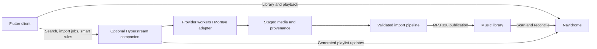

# Hyperstream: new-chat handoff

Prepared 2026-11-11. This is a snapshot of the completed work, user preferences,
and the next exploration. Read the repository before making changes; this file
does not turn proposals into approved requirements.

For subsequent implementations and the November 12 playlist/UI follow-up, read
[the current implementation record](SMART_PLAYLISTS_AND_PROVIDERS.md) and
[device checks](SMART_PLAYLISTS_TESTING.md). `releases/latest.json` identifies the
latest collected pair. The release and proposals below remain a historical snapshot.

## Start here

- Workspace: `D:\Users\Eisen Uchiha\Engineering\Personal\navidrome-hyperstream`
- Repository: https://github.com/victoralvelais/navidrome-hyperstream
- Branch: `main`; application HEAD at handoff: `a92b14046194e413183da2e310f022f46e197d17`.
- Latest collected release: **0.1.0+14**, directory `releases/v0.1.0+14-r1/`.
- [Successful release run](https://github.com/victoralvelais/navidrome-hyperstream/actions/runs/43101552569).
- Previous UI/server-account work is complete. Smart-playlist and provider work
  below is exploration, not implemented functionality.
- The working tree was clean before adding this document. This handoff is a
  documentation-only addition; no new build or test run was needed for it.
- The old conversation became difficult to use: follow-ups failed with
  `Error submitting message` / `Queued follow-up changed before dispatch`.
  The cause has not been diagnosed. Continue in a new chat without restarting
  the project or asking the user to repeat settled decisions.

## Latest request and next direction

The user wants to explore a visual smart-playlist editor inspired by their
`D:\Users\Eisen Uchiha\Engineering\Personal\navidrome-music\recentRadio.py`:
combine recently added and recently played tracks, update automatically, and
allow a custom mixed sorting algorithm.

They also want to understand third-party streaming/acquisition plugins and how
people downloading Hyperstream from the App Store could use them. In particular:
does everyone need Docker, can this be a plugin capability, and who should write
to the Navidrome library? Finish architectural exploration before committing to
an implementation. A sensible first implementation milestone is listening-history
reporting plus a previewable Recent Radio preset, not an entire plugin marketplace.

## Settled product decisions

- Platform priority: iOS, iPadOS, Windows. Keep Flutter/Dart for shared UI and
  application logic, with small native bridges where needed.
- User comes from TypeScript but accepts other languages if reliable and easy
  to modify manually. `apps/client/pubspec.yaml` is the package manifest;
  `pubspec.lock` is committed. Native hosts are committed too.
- Personal use/sideloading first; possible App Store distribution later.
- No Mac or commercial build service. Use GitHub Actions for native releases.
- Navidrome currently runs in Docker on the user's Windows PC.
- Third-party acquisitions belong on the **Navidrome server only**.
- Library output: **MP3, 320 kbps**. Discard staged FLAC only after validated
  conversion and publication succeed; retain failed inputs for recovery.
- Mornye was suggested because it used to be SpotiFLAC and has a provider
  ecosystem. The user has not chosen two specific providers. Metadata providers
  and actual audio sources must remain distinct in our data model.
- Secure saved accounts and staying connected are priorities. Multiple saved
  servers are now implemented; one server is active at a time.
- Independent app volume, optional iOS audio mixing, and an always-present
  previous/restart button are important. Mixing does not promise playback through
  every phone call or system interruption.
- No prominent logout button. Disconnect/account management lives in Settings.

## UI direction and completed revisions

The user wants an immersive, sleek music interface with Apple-style glass,
dark/light modes, strong readable song typography, and compact controls.
Selected concept combination: A/C navigation and search, B atmosphere and vertical
volume, C mini-player with previous/restart added permanently.

Completed in the latest release:

- Stronger song typography; artwork-colored backgrounds and shared glass surfaces.
- Home/Search/Library navigation; adaptive wide layouts.
- Settings is reached from Home, with grouped rows/sections. It is not a main
  toolbar destination. Settings supports adding, switching, and removing servers.
- Empty Search serves as Discover: Recently Added, Most Played, Rediscover,
  favorite albums, and server genres. This currently discovers the selected
  Navidrome library, not external charts or provider catalogs.
- Mobile floating glass dock collapses while scrolling down and expands on
  scrolling up/navigation. Previous, play/pause, and next remain available.
- Pull-to-refresh replaces UI refresh buttons. Error Retry actions remain;
  focused lists also support F5. Playlist creation is a small plus by its heading.
- Icon-triggered vertical volume capsule with drag, mute, and percentage.
- Expanded player groups output selection with volume. iOS uses AVRoutePickerView;
  Windows selects this app's output device. This is not Chromecast, Spotify
  Connect, or playback handoff to another Hyperstream installation.
- Reduced-transparency/opaque options and accessibility fallbacks. Flutter glass
  is an approximation, not native Liquid Glass rendering.

Reference locations:

- Original [Reddit inspiration](https://www.reddit.com/r/UI_Design/comments/1wrj8d5/how_can_i_improve_the_uiux_of_my_app_more/).
- Concept boards: `design/concepts/2026-11-11/`, including
  `selected-direction-v1.png` and selection metadata.
- User screenshots: `\\KIRA\share\hyper stream\`: `settings.heic`,
  `add multiple servers.heic`, `search-discover.heic`,
  `choose streaming device.heic`, `glass floating dock collapsed.heic`,
  `glass floating dock full.heic`, and
  `remove refresh, move settings to home, and shrink new playlist button.heic`.
- Viewable local copies: `.tools/design-references/user-revisions/`.
  Some `.heic` attachments actually contain PNG bytes; extension alone does not
  identify the format. Do not modify the original references.
- Actual app render previews: `apps/client/build/previews/`, covering phone dark,
  phone light, small phone, tablet, desktop, and key screens.

## Current architecture and code map

The Flutter client talks directly to Navidrome using OpenSubsonic. Acquisition
is a separate Python prototype and is **not connected to the client yet**.

| Area | Location / important behavior |
| --- | --- |
| Startup/session | `apps/client/lib/main.dart`; restores account session and initializes playback |
| Navidrome API | `apps/client/lib/services/navidrome_client.dart`; salted token auth, rejects redirects, sanitizes errors |
| Models | `apps/client/lib/models/library.dart`; Track does not yet model added/last-played/play-count fields |
| Playback | `apps/client/lib/services/playback_service.dart`; queue, seeking, previous/restart, volume/mute, preferences |
| Secure accounts | `apps/client/lib/services/account_store.dart`; encrypted multi-server schema with single-server migration |
| Account changes | `apps/client/lib/services/account_session.dart`; validates connection before replacing active session/queue |
| Sign-in | `apps/client/lib/features/connect/connection_screen.dart`; saved servers and reusable sign-in form |
| App shell/Home | `apps/client/lib/features/library/library_screen.dart` |
| Search/Discover | `apps/client/lib/features/search/library_search.dart`, `discover_page.dart` |
| Settings page | `apps/client/lib/features/settings/settings_sheet.dart` (historical filename) |
| Player controls | `apps/client/lib/features/player/player_controls.dart`, `volume_button.dart`, `output_button.dart` |
| Glass/refresh | `apps/client/lib/widgets/`; theme in `app_theme.dart` |
| iOS bridges | `apps/client/ios/Runner/AppDelegate.swift`; native route picker and accessibility appearance |
| Windows audio fork | `apps/client/packages/just_audio_windows/`; app output enumeration/selection |
| Import worker | `hyperstream/importer.py`, `hyperstream/__main__.py` |
| Mornye hook | `hyperstream/mornye_hook.py` |
| Release automation | `tools/release.py`, `tools/release_artifacts.py`, `.github/workflows/ios-sideload.yml` |

Account persistence uses iOS Keychain and Windows DPAPI, not ordinary preferences.
Server switching must not leak credentials, cached library data, or listening events
across accounts. Temporary sign-in and failed switches must preserve unrelated
saved accounts. Never print credentials, GitHub tokens, or signed artifact URLs.

Navidrome playlists and favorites already work. Own playlists support creating,
renaming, adding songs, and removing positions. The protocol does not provide
atomic conflict handling for all playlist edits; existing removal checks server
order before mutation.

**Important missing feature:** Hyperstream does not yet submit listening-history
scrobbles. The existing Recently Played/Most Played sections read server history.
Do not claim new Hyperstream plays update smart playlists until reporting is built.
Offline downloads, queue persistence, shuffle/repeat, and lyrics are also pending.

## Smart playlists: script findings and proposal

The supplied script was read, not executed or modified. It opens a read-only
Navidrome SQLite database at `file:data/navidrome.db?mode=ro` relative to its working
directory, then writes `Recently Radio.m3u` into the user's real music folder.

Its intended preset is:

1. Include a track if added OR played in the last 30 days.
2. Sort descending by the later of its added timestamp and last-play timestamp.
3. Write extended M3U entries with paths adjusted by removing the first `Music/`.

It runs once per invocation; scheduling is external. Its annotation join has no
user filter, so it can incorporate other users' plays. Reimplement the intended
behavior with explicit per-user aggregation and normalized timestamps; do not
copy its database coupling into the mobile client. The SQL's grouped/scalar
expressions have not been validated in this exploration. Do not run it casually:
it overwrites the actual output playlist.

### Native rules versus custom mixing

Current Navidrome documentation supports `.nsp` rules and API-created smart
playlists; the latter require no file/scan. Native rules include time filters,
multiple sort fields, and refresh delay; interactions follow playlist ownership.
Multi-field sorting is not the same as computing the maximum of two dates or
weighted interleaving. The documented rule format does not establish either
custom algorithm. Verify the installed server version, API/authentication, and
capabilities before implementation; do not assume the standard Subsonic API
can write native rules. [Navidrome smart-playlist documentation](https://www.navidrome.org/docs/usage/features/smart-playlists/).

Recommended split:

- Use native Navidrome rules for definitions the installed version can express.
- Use a Hyperstream evaluator for custom mixtures, saving the resulting ordered
  track IDs into an owned ordinary Navidrome playlist so other clients can play it.
- Keep the definition separate from the generated playlist, with an explicit
  generated/managed state. Do not silently overwrite a user's manual edits.
- A client-only evaluator can refresh while the app is active. A companion can
  update while phones are closed. Do not depend on reliable iOS background timers.
- Prefer versioned API adapters for library/history data. Investigate available
  per-track history fields first. If a read-only database adapter is necessary,
  make it an explicit server-admin option, never a database-write integration.

Proposed editor, following the grouped Settings design:

| Section | Controls |
| --- | --- |
| Include | Any/all rule groups; added within N days; played within N days; favorites/genres later |
| Order | Recent activity (script behavior), or mixed pools |
| Mix | Relative share of newly added and recently played; newest-first or seeded shuffle within each pool |
| Variety | Track limit, optional artist spacing, exclusions/pins, deduplication |
| Refresh | On open; background policy if companion available; last refresh and next refresh |
| Preview | Result count, sample ordering, why each track matched, save/update |

For mixed pools, weighted round-robin is a clear starting algorithm. For example,
60% added / 40% played is an illustration, **not a user-selected default**. Dedupe
overlap, define how overlap counts toward each share, backfill when a pool runs out,
and use a stable seed for each refresh. Avoid automatically rearranging an active
playback queue when the saved playlist changes. Store definitions under
`(server identity, user identity, definition ID)`.

First implementation sequence proposed:

1. Check server capabilities and add reliable scrobble reporting with meaningful
   listening-time thresholds, pause/seek handling, account isolation, and a
   deliberate retry policy (Subsonic does not promise idempotent submissions).
2. Create a versioned, declarative definition and pure evaluator for the script's
   Recent Radio preset. Test eligibility boundaries, missing dates, account scope,
   deterministic ordering, pool overlap, and exhausted pools.
3. Build the editor and preview, then save a generated playlist. Keep refresh
   from clobbering manual playlists or the current queue.
4. Add companion scheduling/event-triggered refresh and custom mix controls.

## Third-party providers: recommended architecture

Keep Flutter as the client. Extend the existing Python work into an optional
authenticated companion, with a versioned API and typed client models. Docker
is one way to ship it, not a requirement of the architecture.



### How other people would use it

One companion is installed per Navidrome deployment, by its administrator. Other
listeners install the app and pair with that deployment; they do not each need
Docker. Propose an endpoint/token or QR pairing flow, with an optional companion
connection attached to each saved server. Listening remains fully usable without
it. Acquisition controls reflect actual server permissions/capabilities.

Packaging options, in sensible order:

1. Docker Compose for administrators already running Navidrome in Docker.
2. A Windows installer/service with a setup wizard and bundled dependencies.
3. Hosting-provider integration or a managed offering later.

A remote hosted companion cannot write into an arbitrary private music folder
without a local agent, deliberate shared storage, or a supported import service.
Moving it to a public server does not eliminate that connection requirement.

### Plugin permissions and media flow

Plugins can expose capabilities such as `search`, `resolve`, `stream`, and
`acquire`. Streaming and adding to the library are separate operations; a provider
may support one and not the other. Metadata availability does not imply access to
the audio. Keep provider authorization and recording identity/provenance explicit.

Let plugins **request an import**, but let the host control library publication.
The host owns destination paths, conversion profiles, validation, duplicate and
conflict handling, durable jobs, cleanup, and Navidrome indexing reconciliation.
Do not give every plugin unrestricted access to the final library or arbitrary
client-supplied filesystem paths. Run third-party code with actual OS/container
restrictions; an in-process Python interface alone is not a security sandbox.
Credentials belong on the server under account/provider scope.

Where an authorized provider supports streaming, return a suitable playback
session to the client and address URL expiry, seeking/range support, and any
required official SDK/DRM constraints. Do not equate downloading a file with a
working pre-import streaming implementation.

Mornye-Python currently documents a versioned REST interface for resolution,
search, queued downloads, status/history, and installed extensions. Its listed
endpoints do not establish pre-import streaming; results intentionally omit file
paths. A verified server-side completion/artifact handoff remains necessary.
Keep Mornye behind an adapter and pin tested backend/extension versions; do not
assume every mobile extension is compatible. [Mornye REST documentation](https://github.com/mornyeapp/Mornye-Python/blob/main/docs/guide/rest-api.md).

Navidrome's own WASM plugins support metadata, scrobblers, scheduled tasks, and
events, with permission-controlled access. That makes a small event/automation
bridge worth investigating. These docs do not establish a general writable
acquisition/conversion host, so replacing the companion with a Navidrome plugin
is an unproven option. [Navidrome plugin documentation](https://www.navidrome.org/docs/usage/features/plugins/).

### App Store implications

A companion is a deployment choice, not an App Store exemption. Apple's rules
require authorization for third-party media downloading/conversion and service
access. Server-side execution does not remove that requirement. Section 2.5.2
restricts downloaded executable app functionality; section 4.7 permits certain
plugin/software models with additional conditions, not a blanket exception.
Keep the shipped client declarative, document all functionality for review, and
evaluate each provider's authorization before offering it in an App Store build.
Approval has not been established. [Apple App Review Guidelines, 2.5.2, 4.7, 5.2.2–5.2.3](https://developer.apple.com/app-store/review/guidelines/).

## Existing import prototype: important boundaries

The Python prototype has a SQLite journal, CLI, Mornye completion hook, and real
FFmpeg conversion. It validates codec, bitrate, duration, core metadata, artwork
count, and decodability. It publishes without replacing an existing destination,
then removes the staged source. Ten import tests previously passed on Windows
with Python 3.13 and FFmpeg, including recovery/conflict cases.

There is no authenticated companion HTTP API, Flutter acquisition UI, live Mornye
provider integration, or confirmed Navidrome indexing integration yet. The hook
was tested with documented-interface fake objects. `published` currently means a
file exists, not that Navidrome has indexed it.

The prototype root is isolated; **do not aim it at the existing music library**.
Atomic publication currently uses hard links, requiring compatible storage and
the state/library directories on the same filesystem. Docker bind-mount behavior
has not been verified. A prior Docker execution request was declined; do not
quietly retry that experiment. See `README.md`, `ROADMAP.md`, `Dockerfile.prototype`,
and `compose.prototype.yml` for exact limitations and proposed verification.

## Build, validation, and local tools

- PowerShell on Windows. Flutter: `D:/Tools/flutter/bin/flutter.bat`;
  Dart: `D:/Tools/flutter/bin/dart.bat`.
- Tested/pinned Flutter **3.47.9**, Dart **3.13.7**.
- Python 3.13; FFmpeg at `D:/Program Files/FFmpeg/bin/ffmpeg.exe`.
- CI: `macos-26`, Xcode **26.6**, unsigned physical-device iOS release;
  `windows-2022` with Visual Studio 2022 for Windows x64.
- The local machine previously lacked the matching VS2022/ATL toolchain. Use
  CI for native releases rather than assuming a local Windows build works.
- Windows output enumeration uses C++20 coroutines in the vendored audio package.
  Its CMake target and standard-conforming member declarations are intentional.
- `pubspec.yaml` remains `0.1.0+1`; CI supplies the release build number.
- Latest prior checks: **88 Flutter tests passed**, analyzer/formatting passed,
  five responsive preview configurations reviewed. Recorded logs are under
  `.tools/revisions-*.log` (ignored local files).
- Native Windows CI checks passed for secure multi-server storage and output
  enumeration/default-device selection/invalid-device rejection. Real AirPlay,
  headphones, and comprehensive interruption behavior still need device testing.
- User confirmed Windows and an earlier sideloaded iPhone build working. Do not
  imply the user has physically tested every new control in release 14.

From `apps/client`, normal checks:

```powershell
& D:/Tools/flutter/bin/flutter.bat pub get --enforce-lockfile
& D:/Tools/flutter/bin/flutter.bat analyze --no-pub
& D:/Tools/flutter/bin/flutter.bat test --no-pub
```

The manifest/lockfile are authoritative. A local pub advisory lookup previously
returned HTTP 403; `pub get --offline` worked with the existing cache. Hosted
restore succeeded. Do not update dependencies casually to work around it.

From a clean, committed, pushed repository root:

```powershell
python -u tools/release.py build
# Resume collecting a specific completed run:
python -u tools/release.py fetch --run-id 43101552569
```

The helper authenticates through the existing Git credential helper, waits for
both jobs, verifies metadata/checksums, and downloads a matching pair. Artifacts:

- `releases/v0.1.0+14-r1/hyperstream-0.1.0+14-ios-unsigned.ipa`
- `releases/v0.1.0+14-r1/hyperstream-0.1.0+14-windows-x64.zip`
- `releases/v0.1.0+14-r1/windows/hyperstream_client.exe` with adjacent DLLs/data
- `release.json`, `SHA256SUMS.txt`, and root `releases/latest.json`

Keep old versions. An EXE alone is not the full Windows distribution. IPA signing
remains local; no Apple credentials are stored in GitHub. Builds are manually
dispatched rather than triggered on every commit. See `docs/ios-github-actions.md`.

## Suggested prompt for the next chat

> Continue Hyperstream in
> `D:\Users\Eisen Uchiha\Engineering\Personal\navidrome-hyperstream`.
> Read `docs/CHAT_HANDOFF_2026-11-11.md` and inspect the current repository first.
> The UI/multiple-server release is complete at 0.1.0+14. Next, help me explore
> and design smart playlists based on my `navidrome-music/recentRadio.py`, with
> custom mixing, plus the optional companion/provider architecture for streaming
> and adding music to Navidrome. Preserve the settled product/UI/security choices.
> Separate existing functionality from proposals and start with the smallest
> useful smart-playlist milestone.
