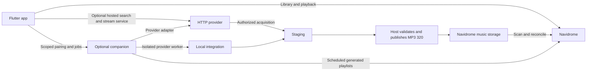

# Smart playlists and optional providers

Design exploration, November 11, 2026. Baseline: released client **0.1.0+14**.
Recent Radio and qualified listen reporting shipped in **0.1.0+15**. That is a
built-in radio, not the requested general smart-playlist system. The follow-up
keeps it hardcoded and separates it from the future editor and custom mixing.
Grouped settings live directly on Home, with navigation ordered
**Home / Library / Search**. The previous handoff remains a historical snapshot.
See the [device test guide](RECENT_RADIO_TESTING.md) for acceptance and limits.

## Built-in Recent Radio: local updates and periodic sync

Recent Radio always uses a 30-day window and recent-activity ordering. Remove
its name/day editor; existing local preference records remain untouched but are
not read or overwritten. Play uses the displayed order; an active queue remains
unchanged when the radio updates.

A qualified listen emits the track and its original start time through the
playback client's local event stream before the scrobble request completes.
Merge it into an account-scoped in-memory catalog and re-evaluate immediately.
This requires no catalog read or per-song request. Local activity can therefore
appear before the server confirms it; the existing Playback notice still reports
uncertain submissions. Local activity is session-only, not an offline outbox.

The first open loads the complete catalog. Later visits reuse it. Pull-to-refresh
and F5 sync explicitly; after each attempt, schedule the next attempt 30 minutes
later while the app is active. The schedule belongs to the account session, so
it continues on other app pages. Pause scheduling in the background; resume
with one sync if overdue. Neither reopening the page nor a short background trip
forces a new scan. Closed-app scheduling belongs to the later companion.

Coalesce concurrent syncs and retain local events that arrive during a scan.
Overlay more recent local history until server history catches up. A subsequent
complete scan owns catalog membership, including deletions. Incomplete/failed
scans retain the current list and its actual last-sync timestamp. Stop timers and
subscriptions on account disposal. List re-evaluation also removes expired dates.

### Exact preset semantics

The source is the user's `../navidrome-music/recentRadio.py`, inspected without
executing or modifying it. Preserve its intention, not its SQL coupling:

- Take one UTC evaluation time. The window is a rolling `30 * 24 hours`.
- Include a track when added **or** last played is at or after the cutoff.
- Sort descending by `max(addedAt, lastPlayedAt)` over valid timestamps.
- Break equal timestamps by stable Navidrome track ID. Deduplicate by track ID
  within the current server/account; do not merge different recordings by title.
- A missing date contributes nothing; a track with both dates missing is omitted.
  Reject malformed timestamps; flag future dates as clock anomalies rather than
  letting them dominate the mix. Never substitute album dates for track dates.
- Play history belongs to the signed-in user. The script's annotation join lacks
  a user filter; reproducing that would mix listeners' histories.
- Keep all matches by default. A later user-selected limit applies after ordering;
  pagination of the preview must not silently truncate the underlying result.

Example, evaluated at 2026-11-11 18:00 UTC with a 30-day window:

| Track | Added | Last played | Result |
| --- | --- | --- | --- |
| Older favorite | August 1 | November 11 17:00 | First, played recently |
| New discovery | November 10 12:00 | Never | Second, added recently |
| Both pools | November 9 12:00 | November 10 09:00 | Third, activity is the play date |
| Boundary | October 12 18:00 | Never | Included at the exact cutoff |
| Inactive | October 1 | October 2 | Excluded |

### API feasibility and capability check

OpenSubsonic's track response documents `created`, `played`, and `playCount`.
These are the first candidate inputs for `addedAt`, `lastPlayedAt`, and listening
counts. They are optional fields, so absence alone cannot distinguish a never
played track from an unsupported server. Verify a known played track and the
installed server's behavior. [Track response](https://opensubsonic.netlify.app/docs/responses/child/).

The local compose file declares `deluan/navidrome:latest`; that does not identify
the running version. No authenticated live capability check has been performed
in this exploration. Before implementation acceptance:

1. Retain server type/version from the existing `ping` response; record supported
   OpenSubsonic extensions where available. Do not infer support from `latest`.
2. Check `getSong` and the existing empty-query `search3` browsing path for those
   fields, per-user isolation, timezone semantics and permissions.
3. Fetch the full song candidate set with pagination. Recent album lists cannot
   find every recently played song. Deduplicate pages and discard a canceled or
   stale account generation; incomplete loads must not look like complete results.
4. Measure a representative large library before adding an index/cache. Keep
   any cache scoped to server and user. If available data cannot produce the
   promised preset, explain the unsupported capability rather than silently
   showing only recent additions or this device's partial history.

Prefer the working OpenSubsonic path. Navidrome's separately documented API v1
is explicitly a work in progress; its development spec is not a stable production
contract. A native adapter needs verification against the installed version.
[Navidrome API v1 status](https://www.navidrome.org/docs/developers/api-v1/).

### Listening-history behavior

`scrobble` distinguishes a now-playing notification from a completed submission;
submissions update play counts and last-played timestamps and may also reach a
server-configured external scrobbler. Send the original listen time as Unix
milliseconds. [OpenSubsonic scrobble](https://opensubsonic.netlify.app/docs/endpoints/scrobble/).

Current counting policy: for tracks longer than 30 seconds, submit after
listening to half the duration or four minutes, whichever is shorter. This is a
product default to evaluate, not a protocol requirement or a settled preference.
Count actual playing time using a monotonic clock; pauses, buffering and forward
seeks do not earn listening credit. Unknown durations wait for a valid duration.
One playback instance can submit once; an actual replay starts a new instance.
Seeking within a track does not create one.

Bind each event to the client/account generation that started it. Stop collecting
on reset/switch/disconnect. A late completion cannot refresh another account or
send the previous account's track through new credentials. Now-playing events
must not count as completed listens. Provide a reporting toggle under Home's
Playback page, explaining that server scrobbling settings also apply.

The initial implementation makes one attempt per playback instance, with no
automatic retries. A timeout or broken response can mean the server accepted
the event. Deduplicate
dispatch locally by playback instance. Do not promise exactly-once delivery or
offline history until a durable scoped outbox and reconciliation strategy exist.
The monotonic tracker samples each second while audio is ready/playing and
discards unobserved gaps longer than five seconds. It excludes time waiting for
native seeks and cancels sampling on reset/disposal. No now-playing notification
is submitted by this milestone.

### Acceptance

- An eligible Hyperstream listen updates Recent Radio immediately without a
  library request, including while its server submission is pending or uncertain.
- The 30-minute timer, explicit refresh, resume-after-overdue behavior, and
  duplicate-trigger coalescing are covered by controllable-clock tests.
- Tests cover cutoff equality, missing/invalid dates, timezone normalization,
  ties, deduplication, complete pagination, and failed/ambiguous submissions.
- Switching accounts mid-load or mid-listen cannot leak events, lists or caches.
- Syncs cannot undo newer local activity; Play uses the exact displayed snapshot
  without later radio updates mutating the playing queue.
- API fixtures pass; installed-server and locked-device behavior still require
  device acceptance. Fixtures alone do not establish deployment compatibility.

## Next real smart-playlist milestone: rules and custom mixing

Keep the fixed radio as its own entry. A separate **New smart playlist** editor
must create multiple named, saved definitions, with independent added/played
windows, an include combination (either/both), and selectable recent-activity or
weighted added/played ordering. Preview results before saving; reopening a saved
definition must retain its rules and mixing settings. This is the smallest useful
builder to implement next. A renamed radio or exported static snapshot alone does
not meet this milestone. Favorites/genres/exclusions and artist spacing can follow.

Keep rules separate from UI and network access. Version each declarative definition
and store it under server/user/definition identity. Reject unknown schema versions
without overwriting them. Reuse scoped catalog snapshots and local listen updates;
keep the fixed radio independent. No companion is required for the editor.

After that, add **Save to Navidrome**, creating an owned ordinary playlist with the
preview's ordered IDs. Persist its ID and the ordered sequence last written
alongside the definition. Show that it is generated and when it was refreshed.
On refresh, read the remote sequence and ownership before writing. If another
client edited it, pause automatic updates and offer Keep manual / Create copy /
Explicitly regenerate. Do not adopt or replace an existing playlist by name.
Serialize refreshes per definition, re-read after writes, and surface conflicts.
The existing playlist API cannot guarantee an atomic compare-and-swap, so a race
between checking and writing remains a documented limitation. A missing playlist
or changed owner needs explicit recovery. A failed refresh preserves the last
successful result and must not publish a partial or error-induced empty list.

The editor's **Custom mix**, alongside **Recent activity**, should use:

| Control | Proposed behavior |
| --- | --- |
| Added / played balance | Adjustable shares; no ratio has been selected by the user |
| Pool ordering | Newest first, later a deterministic seeded shuffle |
| Day windows | Separate added/played windows, initialized from the preset |
| Variety | Optional artist spacing, then exclusions and pins |
| Limit | Applied after deduplication and mixing |
| Preview | Show requested shares, actual contributions and any relaxed constraints |

Use smooth weighted round-robin over the eligible added and played pools. At each
step, add the active pools' weights to their scores; take the highest-scoring pool,
emit its next unseen track, and subtract the total active weight from that pool's
score. Break equal scores by a fixed pool order. Zero-weight pools are disabled.

A song in both pools appears once, charged to the pool that emitted it. Skip it
in the other pool without consuming a slot or charging weight. Drop an exhausted
pool and normalize over the remaining positive-weight pools, filling the remaining
slots. If all enabled pools exhaust, return fewer tracks. The ratio describes
contributions, not exclusive membership: an emitted song can match both rules.
The preview should make that visible.

For illustration only, a 60/40 mix with distinct plentiful pools starts
Added, Played, Added, Played, Added. Overlap and exhausted pools change the
achievable ratio. Save a seed/refresh epoch for shuffled pool order, so previews
do not move on every UI rebuild; avoid platform-dependent hash ordering. Artist
spacing initially defaults off; later prefer feasible candidates and report any
relaxation instead of silently discarding the whole result. Test overlap, 0/100
shares, exhaustion and reproducibility before exposing the mix controls.

Navidrome supports native rules from `.nsp` files or API-created playlists and
documents date filters, multiple sort fields and refresh delay. Multiple-field
sorting does not establish a computed maximum of two dates or weighted mixing.
Use native rules only when their semantics match exactly; otherwise generate
ordinary playlists. Verify the installed native API/authentication before writing
rules; Subsonic playlist creation alone does not provide that contract.
[Navidrome smart playlists](https://www.navidrome.org/docs/usage/features/smart-playlists/).

## Providers: adopt an HTTP contract, keep library publication controlled

Eclipse documents URL-installed HTTP addons with a manifest, search and stream
resolution, optional browsing endpoints, and stream expiry metadata. Its library
integration stores addon/track references and stream URLs; that does not establish
Navidrome file imports. This is a useful interface reference, not a verified
compatible implementation. [Eclipse addon guide](https://eclipsemusic.app/docs).

Proposed Hyperstream arrangement:

These are proposals, preserving Flutter, server-only acquisition and MP3 320:

| Capability | Responsibility |
| --- | --- |
| `search` / metadata `resolve` | Provider returns typed identities and metadata; metadata availability does not promise audio |
| `stream` | Provider offers an authorized playback session; specify expiry, format, seeking/range support and renewal |
| `acquire` | Provider offers an authorized server-side artifact/job, independently of streaming permission |
| `library.import` | Companion host authorizes the user and publishes through the import pipeline |
| Playlist scheduling | Companion evaluates definitions for their owning server/user; library listening remains independent |

A plugin may request an import or supply a staged artifact. It does not receive
arbitrary write access to the final library. The host controls paths, deduplication,
conversion, validation, non-overwriting publication, recovery, cleanup and indexing.
Retain failed input; discard staged FLAC only after successful validation and
publication. Mark a job ready only when reconciled to a Navidrome track ID.

An initial versioned HTTP contract would expose capabilities, search, stream
sessions and import jobs. Job creation accepts a provider recording identity and
an idempotency key, never a client-chosen filesystem destination. Store both
requested metadata identity and actual audio-source provenance. Keep plugin IDs
and Navidrome track IDs in separate namespaces. Unimported streams must not be
submitted as Navidrome song IDs or imply membership in a Navidrome playlist.

Pair a companion separately for each saved server. Validate its configured
Navidrome instance and bind a revocable token to the authenticated user and
permitted operations; never trust a client-supplied username as authorization.
Provider credentials stay in the execution service. Do not forward Navidrome
credentials to addon URLs. Shared provider installations must still enforce
per-user authorization, quotas and import access. A capability advertisement is
not an authorization grant.

Use OS/container isolation for untrusted local workers; an in-process Python
interface is not a sandbox. Constrain worker network access, redirects, staging
paths and resource use. Authenticate remote services, validate their responses,
and scope expiring playback URLs narrowly. Streaming should resolve through a
separate player source abstraction; the current player builds Navidrome URLs.
DRM or official-SDK-only sources need their own verified adapter.

Keep Mornye behind an adapter to the existing Python import prototype. Completion
hooks, artifact handoff, supported extensions, streaming and scan reconciliation
still need actual integration evidence. No provider or marketplace is selected
by this design. A first provider proof should use an authorized test source and
isolated storage, without targeting the user's real library or rerunning the
previously declined Docker experiment.

### What a person downloading Hyperstream installs

| Desired use | Required setup |
| --- | --- |
| Play a Navidrome library; active-app Recent Radio | App plus existing Navidrome login |
| Stream from a hosted HTTP provider | App plus provider endpoint/account; no personal Docker instance |
| Import to Navidrome | Admin installs one companion with access to that server's library; listeners pair with it |
| Refresh generated playlists with phones closed | Same companion, scheduled per owning user |

Ship Docker Compose first for this deployment; offer the same companion as a
Windows service/installer later. Listeners sharing a deployment do not each need
Docker. A managed Navidrome host could bundle the companion. A hosted provider
cannot deposit files into a private music folder without a local agent, deliberately
shared storage, or an import endpoint with that access. The companion can be
optional to the app while remaining necessary for that import path.

Navidrome's documented WASM plugin capabilities cover metadata, scrobbling,
scheduling and events. That supports investigating a small event bridge; it does
not establish the existing FFmpeg import worker can run inside a Navidrome plugin.
[Navidrome plugins](https://www.navidrome.org/docs/usage/features/plugins/).

### App Store route

Eclipse's Apple download page currently offers TestFlight; it is not evidence of
a public App Store release approving this architecture.
[Eclipse downloads](https://eclipsemusic.app/download).

Keep the client declarative and provider code on its service. Apple 2.5.2 restricts
downloaded executable functionality, while 4.7 permits some software/plugin models
subject to additional rules. Sections 5.2.2 and 5.2.3 require authorization for
third-party service use and media downloading/conversion. Remote execution does
not establish compliance. Evaluate concrete providers and disclose the full
shipped workflow in review; App Store approval remains unproven.
[Apple review guidelines](https://developer.apple.com/app-store/review/guidelines/).

## Implementation order

1. Verify installed-server activity fields and implement counted listening plus
   the Recent Radio preview/Play milestone above.
2. Save definitions and owned generated playlists, with conflict-aware refresh
   while the app is active; then add the custom mix controls.
3. Prove one authorized provider's streaming and server import paths separately.
   Add authenticated companion pairing and import jobs around that proof.
4. Add companion scheduling, deployment packaging and optional provider discovery.
   Revisit native-rule optimization and a Navidrome event bridge only when useful.

Unresolved evidence: installed Navidrome version/field semantics, full-library
performance, provider permissions/compatibility, secure companion identity binding,
Windows Docker publication behavior, and live indexing. None requires delaying
the independent Home navigation correction.
