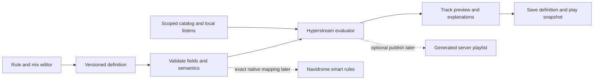
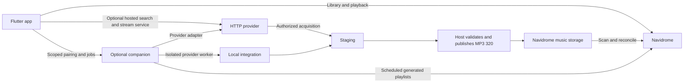

# Smart playlists and optional providers

Design and implementation record, updated November 13, 2026. The matched sideload
release is recorded in `releases/latest.json`.
Recent Radio and qualified listen reporting shipped in **0.1.0+15**; **0.1.0+17**
keeps the radio fixed at 30 days, updates it locally from counted listens, and
syncs on refresh/every 30 minutes while active. The user subsequently selected
both **Rules** and **Mix** as editor types. The first configurable milestone is
implemented; the scope below distinguishes it from the broader proposals.
Grouped settings live directly on Home, with navigation ordered
**Home / Library / Search**. The previous handoff remains a historical snapshot.
See the [device test guide](RECENT_RADIO_TESTING.md) for acceptance and limits.

The November 12 UI follow-up puts saved smart playlists at the top of the same
searchable playlist list as server playlists and Recent Radio. The plus menu has
only New playlist and New smart playlist. Sparkles is the default smart icon;
users can choose icons per playlist, stored separately in account-scoped local
preferences. Existing definition JSON is unchanged. Floating headers, compact
icon/label selection capsules, left-edge Back and artwork-derived page/glass
colors follow the supplied IMG_7046, IMG_7047 and IMG_7049 references. Recent
Radio has no introductory description or idle sync status.

## Selected milestone: Rules and Mix

**Library → Playlists → + → New smart playlist** opens an editor with a type selector. Switching types preserves each
type's settings. The name, exclusions and optional track limit are shared.

- **Rules:** nested all/any conditions and one ordering. Latest activity uses
  `max(addedAt, lastPlayedAt)`; ordinary choices are newest added, most recently
  played, title, artist, least played and stable shuffle. The starting example matches Recent
  Radio, but the saved definition is independently editable.
- **Mix:** 1–8 named pools, each with the same rule builder, its own order and a
  whole-number share. Shares sum to 100%; 0% disables a pool. The starting example
  is added within 30 days at 60%, played within 30 days at 40%; these are editable
  examples, not new fixed radio semantics.
- Available conditions: added/played date windows, never played, favorites,
  play count, duration, title, artist and album. Global exclusions run before
  ordering/mixing. Genre/year/rating and scoring remain later work. Artist spacing
  and stable shuffle are implemented below. Collection playback offers Shuffle separately.
- Mix uses smooth weighted interleaving. Pool order resolves ties; sort ties use
  track ID. Duplicate IDs are skipped without consuming another slot and charged
  only to the pool that emitted the track. Preview reports requested shares and
  actual contributions. Filling from remaining pools is on by default. Turning
  it off stops as soon as any enabled pool has no distinct candidates; this can
  make the playlist substantially shorter, including empty for an empty pool.
- Preview shows up to 50 tracks with reasons; Play uses the entire selected
  result. Changes never reorder an already playing queue. Evaluation above 5,000
  catalog tracks runs in an isolate and discards superseded results.

Definitions use versioned JSON in local preferences, keyed by the canonical
server URI and username. Writes serialize and publish only after storage succeeds;
malformed/newer unreadable data is preserved with editing disabled. This stores
configuration only: no credentials, cross-device sharing or Navidrome playlist
publication. A separate rebuildable disk cache now stores catalog metadata.
Account switching disposes the old catalog and
preview listeners. The same account entered through a different server URL has a
separate definition store, matching existing connection identity semantics.

Recent Radio and all smart playlists share one account catalog and one 30-minute
foreground schedule. Local qualified listens overlay both the last-played time
and a provisional play-count floor; refresh takes the greater remote/local count
until server history catches up, avoiding double counting. Successful song-favorite
changes also update the catalog immediately. Neither operation triggers a scan.
Local overlays persist with the cached catalog; reporting-disabled listens produce
no overlay. Cached listen records are never replayed as network submissions.
Initial/full sync retains the existing Navidrome activity-metadata compatibility
guard. Missing history must be investigated on the actual server, not silently
treated as a complete recent-played library.

See [smart-playlist device checks](SMART_PLAYLISTS_TESTING.md). The fixed Recent
Radio entry and deferred addon architecture remain intact.

### Variety and stable shuffle: November 13 follow-up

The user delegated milestone priority while testing playback recovery. Start with
these additions to both existing editor types; keep built-in Recent Radio fixed.

- **Stable shuffle** is an order for Rules or an individual Mix pool. A saved
  playlist seed and stable track-ID hash determine rank. Catalog iteration order,
  process restart, clock changes and local listens never reseed it. With unchanged
  eligible tracks/settings, evaluation repeats the same selection/order. Membership,
  pool and spacing changes can still alter track positions.
- **Reshuffle** in preview changes the unsaved editor's seed; Save commits it.
  On a saved playlist, Reshuffle commits the new seed before publishing a result.
  Failed writes keep the old definition/order; concurrent changes serialize.
  Neither action requests a catalog scan or modifies the playing queue.
- **Artist spacing** is shared by Rules and Mix, default Off (0). Choose 1–10
  other songs between repeated primary artists. Use the primary artist ID when
  available, otherwise a trimmed/case-folded/whitespace-normalized display name.
  Blank/Unknown artist metadata does not group unrelated tracks into one artist.
  Featured credits are not parsed from display names.
- **Relax spacing when necessary** is on by default. Only when no pool has a
  feasible candidate, reduce the gap as little as necessary for that selection.
  Turning it off stops at the first unsatisfiable gap. Preview reports relaxed
  selections or a strict stop; exclusions and deduplication are always enforced.
- Mix checks spacing across all pool boundaries. Temporarily blocked tracks stay
  eligible for later slots; a pool with blocked tracks is not considered empty.
  The existing fill/stop-on-exhaustion policy still applies to actual exhaustion.
  Requested and actual pool contributions remain visible because spacing can
  make the requested shares impossible.
- **Play** uses the evaluated selection/order and spacing. The existing transport
  **Shuffle** randomizes the selected tracks and bypasses spacing; its behavior is
  unchanged. Preview explains this. Queue edits, manual jumps and repeat wrapping
  are not constrained by playlist-generation spacing.

Definition schema 2 stores `artistGap`, `relaxArtistGap` and `shuffleSeed`.
Schema 1 remains readable with spacing Off and seed 0; merely loading never writes
or changes its ordering. The account-store envelope/key stays version 1. Unknown
definition versions remain protected against overwrite. Stable ranks are SHA-256
of JSON `[playlist ID, seed, track ID]`, with track ID breaking ties. The shared
seed gives overlapping pools consistent per-song ranks without tying rank to pool
name or index. Large previews still run in an isolate.

Selection keeps a sorted head per artist in each pool. Blocked runs can be skipped
without repeatedly scanning the whole library; used tracks are removed lazily
across overlapping pools. Tests cover the old ordering behavior, migration,
scarcity, artist identity, stable/local-update ordering, mixed-pool spacing,
failed/serialized reshuffles, unchanged playback and a large same-artist library.

## Built-in Recent Radio: local updates and periodic sync

Recent Radio always uses a 30-day window and recent-activity ordering. Remove
its name/day editor; existing local preference records remain untouched but are
not read or overwritten. Play uses the displayed order; an active queue remains
unchanged when the radio updates.

A qualified listen emits the track and its original start time through the
playback client's local event stream before the scrobble request completes.
Merge it into an account-scoped in-memory catalog and re-evaluate immediately.
This requires no catalog read or per-song request. Local activity can therefore
appear before the server confirms it; the existing Playback notice still reports
uncertain submissions. Local activity persists with the catalog, not as an offline
submission outbox.

Once a server connection succeeds, opening the account starts the shared catalog
loader in the background, including the initial full scan if no valid cache exists.
The sign-in/recovery screens never start this work. Later visits and
app restarts restore the last complete catalog from disk and re-evaluate dates
immediately. A due background refresh does not block playing the cached list.
An existing cache restores when its account opens, so listens made without visiting
the playlist page still persist. Recent Radio and smart-playlist pages reuse the
startup request; entering them does not create a second scan or block navigation.
Pull-to-refresh and F5 sync explicitly; after each attempt, schedule the next attempt 30 minutes
later while the app is active. The schedule belongs to the account session, so
it continues on other app pages. Pause scheduling in the background; resume
with one sync if overdue. Neither reopening the page nor a short background trip
forces a new scan. A restored cache uses its saved successful-sync time to schedule
the next refresh. Closed-app scheduling belongs to the later companion.

Catalog cache files live in application support, scoped by a SHA-256 digest of
canonical server URI and username. Version 1 stores track metadata, last successful
sync time, pending local activity floors and favorite overlays; it stores no
credentials, signed URLs or audio. JSON encoding/decoding runs in an isolate.
Writes serialize per account and replace the previous file atomically. Local
changes debounce saves for one second and flush when the account pauses/disposes.
Missing, corrupt or incompatible caches fall back to a full scan. A failed scan
never replaces the last complete snapshot. This removes the repeated startup
wait, but periodic/manual reconciliation still reads the full catalog so deletions
and activity from other clients are discovered. Incremental server queries remain
future work requiring installed-server compatibility evidence.

Coalesce concurrent syncs and retain local events that arrive during a scan.
Overlay more recent local history until server history catches up. A subsequent
complete scan owns catalog membership, including deletions. Incomplete/failed
scans retain the current list and its actual last-sync timestamp. Stop timers and
subscriptions on account disposal. List re-evaluation also removes expired dates.

### Sync status follow-up: implemented

Recent Radio now displays a progress bar and the **total number of tracks being
synced**, for example a bar above `12,430 tracks`. The changing fetched-count
sentence is removed. Smart-playlist syncs reuse this status component. The total
is the catalog being synced, not the number of tracks that match the playlist.

On an identified Navidrome connection, an optional native request reads
`GET api/song?_start=0&_end=1&missing=false` and validates its `x-total-count`
header and one-row JSON response. It uses the existing server/account through
`POST auth/login`, checks the returned username, and keeps its bearer token only
in client memory. Both requests preserve reverse-proxy prefixes and disable
redirects. No native session is written to preferences or logs. An expired cached
token can be renewed once; other failures fall back without rejecting the working
OpenSubsonic sign-in. Each optional request has a four-second timeout.

The count follows Feishin's one-song request pattern. Source review of Navidrome
at `a7f19c7c7ad39bfb3a3d6128616d9b0cb7644397` confirms that native CountAll and
search3 use the user's library-access filter; search excludes missing tracks,
so the count explicitly uses `missing=false`. Navidrome scanner status is a
different operation and is not used as this denominator. The installed server
has not been exercised with live credentials; device acceptance remains necessary.
[Feishin count implementation](https://github.com/jeffvli/feishin/blob/9182c91c525f83e8d5da3fbb4a0825a793934b28/src/renderer/api/navidrome/navidrome-controller.ts#L863),
[Navidrome count](https://github.com/navidrome/navidrome/blob/a7f19c7c7ad39bfb3a3d6128616d9b0cb7644397/persistence/mediafile_repository.go#L138),
[library access](https://github.com/navidrome/navidrome/blob/a7f19c7c7ad39bfb3a3d6128616d9b0cb7644397/persistence/sql_base_repository.go#L241),
[search filtering](https://github.com/navidrome/navidrome/blob/a7f19c7c7ad39bfb3a3d6128616d9b0cb7644397/persistence/sql_search.go).

Each sync starts with an unknown total, never the prior count. Missing/invalid
headers, native API failures and unknown server types use an indeterminate bar
with “Syncing library”, without a numeric total. Once known, progress reflects
distinct fetched IDs divided by the total, capped at 99% until the final empty
page and metadata validation succeed. If fetched IDs exceed the count, the stale
total is withdrawn and sync continues. A successful sync sets the actual distinct
remote-track total and 100%; session-only listen additions are not included in
that synced count. The UI now hides the bar and total as soon as syncing stops,
on success or failure; the actual count remains available in the catalog model.
Failure retains the previous catalog and its error/retry controls.

The existing manual/30-minute schedule, local updates, failure recovery and account
isolation remain unchanged. Only a sync attempt makes a count lookup; listens,
favorites and page revisits do not. See the expanded device checks.

### Exact preset semantics

The source is the user's `../navidrome-music/recentRadio.py`, inspected without
executing or modifying it. Preserve its intention, not its SQL coupling:

- Take one UTC evaluation time. The window is a rolling `30 * 24 hours`.
- Include a track when added **or** last played is at or after the cutoff.
- Sort descending by `max(addedAt, lastPlayedAt)` over valid timestamps.
- Break equal timestamps by stable Navidrome track ID. Deduplicate by track ID
  within the current server/account; do not merge different recordings by title.
- A missing date contributes nothing; a track with both dates missing is omitted.
  Reject malformed timestamps; flag future dates as clock anomalies rather than
  letting them dominate the mix. Never substitute album dates for track dates.
- Play history belongs to the signed-in user. The script's annotation join lacks
  a user filter; reproducing that would mix listeners' histories.
- Keep all matches by default. A later user-selected limit applies after ordering;
  pagination of the preview must not silently truncate the underlying result.

Example, evaluated at 2026-11-11 18:00 UTC with a 30-day window:

| Track | Added | Last played | Result |
| --- | --- | --- | --- |
| Older favorite | August 1 | November 11 17:00 | First, played recently |
| New discovery | November 10 12:00 | Never | Second, added recently |
| Both pools | November 9 12:00 | November 10 09:00 | Third, activity is the play date |
| Boundary | October 12 18:00 | Never | Included at the exact cutoff |
| Inactive | October 1 | October 2 | Excluded |

### API feasibility and capability check

OpenSubsonic's track response documents `created`, `played`, and `playCount`.
These are the first candidate inputs for `addedAt`, `lastPlayedAt`, and listening
counts. They are optional fields, so absence alone cannot distinguish a never
played track from an unsupported server. Verify a known played track and the
installed server's behavior. [Track response](https://opensubsonic.netlify.app/docs/responses/child/).

The local compose file declares `deluan/navidrome:latest`; that does not identify
the running version. No authenticated live capability check has been performed
in this exploration. Before implementation acceptance:

1. Retain server type/version from the existing `ping` response; record supported
   OpenSubsonic extensions where available. Do not infer support from `latest`.
2. Check `getSong` and the existing empty-query `search3` browsing path for those
   fields, per-user isolation, timezone semantics and permissions.
3. Fetch the full song candidate set with pagination. Recent album lists cannot
   find every recently played song. Deduplicate pages and discard a canceled or
   stale account generation; incomplete loads must not look like complete results.
4. Measure a representative large library before adding an index/cache. Keep
   any cache scoped to server and user. If available data cannot produce the
   promised preset, explain the unsupported capability rather than silently
   showing only recent additions or this device's partial history.

Prefer the working OpenSubsonic path. Navidrome's separately documented API v1
is explicitly a work in progress; its development spec is not a stable production
contract. A native adapter needs verification against the installed version.
[Navidrome API v1 status](https://www.navidrome.org/docs/developers/api-v1/).

### Listening-history behavior

`scrobble` distinguishes a now-playing notification from a completed submission;
submissions update play counts and last-played timestamps and may also reach a
server-configured external scrobbler. Send the original listen time as Unix
milliseconds. [OpenSubsonic scrobble](https://opensubsonic.netlify.app/docs/endpoints/scrobble/).

Current counting policy: for tracks longer than 30 seconds, submit after
listening to half the duration or four minutes, whichever is shorter. This is a
product default to evaluate, not a protocol requirement or a settled preference.
Count actual playing time using a monotonic clock; pauses, buffering and forward
seeks do not earn listening credit. Unknown durations wait for a valid duration.
One playback instance can submit once; an actual replay starts a new instance.
Seeking within a track does not create one.

Bind each event to the client/account generation that started it. Stop collecting
on reset/switch/disconnect. A late completion cannot refresh another account or
send the previous account's track through new credentials. Now-playing events
must not count as completed listens. Provide a reporting toggle under Home's
Playback page, explaining that server scrobbling settings also apply.

The initial implementation makes one attempt per playback instance, with no
automatic retries. A timeout or broken response can mean the server accepted
the event. Deduplicate
dispatch locally by playback instance. Do not promise exactly-once delivery or
offline history until a durable scoped outbox and reconciliation strategy exist.
The monotonic tracker samples each second while audio is ready/playing and
discards unobserved gaps longer than five seconds. It excludes time waiting for
native seeks and cancels sampling on reset/disposal. No now-playing notification
is submitted by this milestone.

### Acceptance

- An eligible Hyperstream listen updates Recent Radio immediately without a
  library request, including while its server submission is pending or uncertain.
- The 30-minute timer, explicit refresh, resume-after-overdue behavior, and
  duplicate-trigger coalescing are covered by controllable-clock tests.
- Tests cover cutoff equality, missing/invalid dates, timezone normalization,
  ties, deduplication, complete pagination, and failed/ambiguous submissions.
- Switching accounts mid-load or mid-listen cannot leak events, lists or caches.
- Syncs cannot undo newer local activity; Play uses the exact displayed snapshot
  without later radio updates mutating the playing queue.
- API fixtures pass; installed-server and locked-device behavior still require
  device acceptance. Fixtures alone do not establish deployment compatibility.

## Feishin implementation review

Inspected the public `development` source at commit
[`9182c91c525f83e8d5da3fbb4a0825a793934b28`](https://github.com/jeffvli/feishin/tree/9182c91c525f83e8d5da3fbb4a0825a793934b28)
on November 11, 2026. This is a source review, not a running-app test or a claim
that every feature is in the user's installed Feishin version. No Feishin code
was executed or incorporated into Hyperstream.

| Observed implementation | Useful guidance for Hyperstream |
| --- | --- |
| Recursive `all` / `any` groups contain conditions and child groups. | Start with a real expression tree, not a fixed list of recent-date toggles. |
| A field/type catalog selects operators and controls for text, dates, numbers, booleans and playlist membership. It includes custom tags. | Share one typed field registry between validation, UI and evaluation; expose fields only when data is available. |
| An ordered sort list serializes to signed, comma-separated field names. Limits can be a count or a percentage. | Keep membership, ordering and limiting distinct. |
| Existing-playlist editing offers visual and JSON modes; its Preview button opens a JSON view. | Add a track-result preview with match reasons and ordering explanations before saving. JSON can be an advanced view later. |
| Creation/editing converts the UI model to Navidrome `rules`, then sends it through the native API. | Separate the portable definition from its storage/execution adapter. |

Sources: [recursive group UI](https://github.com/jeffvli/feishin/blob/9182c91c525f83e8d5da3fbb4a0825a793934b28/src/renderer/components/query-builder/index.tsx),
[field/operator catalog](https://github.com/jeffvli/feishin/blob/9182c91c525f83e8d5da3fbb4a0825a793934b28/src/shared/api/navidrome/navidrome-types.ts),
[sort/limit builder](https://github.com/jeffvli/feishin/blob/9182c91c525f83e8d5da3fbb4a0825a793934b28/src/renderer/features/playlists/components/playlist-query-builder.tsx),
[visual/JSON editor](https://github.com/jeffvli/feishin/blob/9182c91c525f83e8d5da3fbb4a0825a793934b28/src/renderer/features/playlists/components/playlist-query-editor.tsx),
[creation flow](https://github.com/jeffvli/feishin/blob/9182c91c525f83e8d5da3fbb4a0825a793934b28/src/renderer/features/playlists/components/create-playlist-form.tsx).

The inspected API adapter uses `/api/playlist`, `/api/song` and
`x-nd-authorization` bearer authentication. This is a separate integration from
Hyperstream's current OpenSubsonic client and from the proposed `/api/v1` API;
do not conflate them or assume existing salted Subsonic auth is sufficient.
[Feishin native API adapter](https://github.com/jeffvli/feishin/blob/9182c91c525f83e8d5da3fbb4a0825a793934b28/src/renderer/api/navidrome/navidrome-api.ts).

Navidrome documents that these API-created rules live in its database and are
available to other clients without producing an `.nsp` file. It evaluates native
playlists when accessed, subject to its refresh delay; that is not the same as
Hyperstream's 30-minute sync timer.
[Native smart-playlist behavior](https://www.navidrome.org/docs/usage/features/smart-playlists/).

### Where our requirements go further

The inspected smart-playlist builder has no computed latest-of-two-dates sort,
weighted pool mixer, or artist-spacing control. Its multiple-field sorting is
lexicographic: the second field breaks ties in the first. That cannot stand in
for sorting each song by `max(addedAt, lastPlayedAt)`.

For example, a track added yesterday but never played would precede a track added
last year and played today when sorting by addition first. Recent Radio requires
the opposite. The selection expression is straightforward (`added OR played in
30 days`); the computed ordering needs an additional operation. A 60/40 mix is a
different operation again: it chooses contributions from two eligible pools.
This limitation is an inference from the inspected editor/serialization and
documented sort semantics, not a claim that every future server lacks extensions.

## Configuration proposals and selection

These originally compared alternative depths using a common rule model. The
user selected **A and B as separate editor types**, with C reserved for later.
The implemented subset is documented above; variety, scoring and export below
are still design proposals.
Recent Radio remains its own hardcoded feature under every option.

| Proposal | What the listener configures | Strength | Tradeoff |
| --- | --- | --- | --- |
| **A. Rules plus ordering** | Nested all/any rules, exclusions, ordinary sort keys, latest-activity ordering, optional limit. | Familiar Feishin-style editing; a fully configurable equivalent of Recent Radio is possible. | One combined candidate list cannot express deliberate shares from several pools. |
| **B. Rules plus a pool mixer — recommended** | Named pools, each using A's rules and its own ordering; merge by latest activity or interleave with adjustable shares; then variety and limit. | Supports Recent Radio, arbitrary added/played balances, and discovery/favorite mixtures without scripts. | Must explain overlap, exhausted pools and approximate shares. More controls, best organized in stages. |
| **C. Rules plus scoring expressions** | Filters plus typed expressions such as recency decay, favorite boosts and play-count penalties; sort by the resulting score. | Handles nuanced ranking beyond preset sorts and fixed mixing ratios. | Harder to explain, tune and preview. Scores do not guarantee a mix percentage. Highest implementation/validation cost. |

### A: familiar rule groups with computed ordering

Example configuration, expressed as UI choices:

```text
Include ANY
  Added within 30 days
  Played within 30 days
Exclude
  Duration shorter than 45 seconds
Order
  Latest of: Added date, Last played date — newest first
Limit
  All matching tracks
```

This is a genuine saved rule definition, independently named and editable. It
can express the current radio by removing the duration exclusion, but does not
change the fixed Recent Radio entry. Normal sorts and the computed latest-date
sort use the same ordered-list interface; users need not enter a formula.

### B: compose pools with the same rule builder

An illustrative mix (shares and limits are examples, not selected defaults):

| Pool | Conditions | Within-pool order | Requested share |
| --- | --- | --- | --- |
| New discoveries | Added within 14 days; play count below 3 | Newest added | 50% |
| Current rotation | Played within 30 days | Most recently played | 30% |
| Rediscover | Favorite; not played within 90 days, including never played | Stable shuffle | 20% |

Then deduplicate by server track ID, optionally space artists, and take at most
100 tracks. The same model must also offer **Merge by latest activity** over the
added and played pools; weighted interleaving must not be mislabeled as the
original Recent Radio algorithm.

Proposed mobile flow: **Choose songs → Arrange the mix → Variety & limit → Preview**.
Each pool is a card with a plain-language summary and an Edit rules action. Nested
groups open into their own editor on narrow screens, avoiding deep horizontal
indentation. Desktop can keep the settings and resulting tracks side by side.
Simple playlists start with one pool; advanced controls expand when needed.

Preview shows actual tracks, why they match, the pool that supplied each slot,
requested versus achievable shares, and any relaxed spacing. Separate **matched**
count from final **selected** count. Saving a definition must not create or modify
a server playlist implicitly. Playing uses that exact result snapshot.

Define mixing behavior before implementation:

- Use smooth weighted round-robin for proportional interleaving, not independent
  random draws. Break equal scores by saved pool order; zero-weight pools are off.
- A track matching several pools appears once and is charged only to the pool
  that emits it. Skip duplicates in other pools without consuming their turns.
- If a pool runs out, offer a policy: fill from remaining pools (recommended
  default), or stop when the requested distribution cannot continue. Report the
  achieved contributions rather than promising exact quotas for every prefix.
- Apply global exclusions before selection, deduplication during selection, and
  the final limit after mixing. Do not truncate each pool before building the mix.
- Artist spacing, when added, checks the candidate against recently emitted
  artist IDs. Define primary versus any credited artist explicitly. Backfill from
  feasible candidates; offer strict stop versus relaxed spacing with a notice.
- Shuffle uses a stored seed/epoch. Local listen updates must not accidentally
  reseed every unrelated track. An explicit Reshuffle action changes the seed.
- A sample such as 60/40 with ample disjoint pools begins Added, Played, Added,
  Played, Added. Overlap, scarcity and spacing can alter the achieved distribution.

### C: advanced scoring, without executable scripts

For listeners who eventually need more than B, expose a bounded expression editor:
typed date/number fields, latest/earliest, arithmetic, normalization and recency
decay. An example ranks recently added music more highly, boosts favorites, and
reduces the score of overplayed tracks. Preview explains each score contribution.
Treat this as a later ordering option using the same saved model; avoid a separate
Python/JavaScript execution environment. It is not needed for the initial mixer.

## Proposed execution and persistence

Keep the model independent of Feishin's UI and Navidrome's JSON: a versioned
definition with identity, server/user scope, rule tree, pools, ordering/mixing,
optional variety, limit, and shuffle/update policy. Use typed nodes rather than
SQL snippets. Define missing dates/fields, case matching, timezone boundaries,
invalid input and tie-breaking once. Empty/unfinished conditions must not silently
turn into a whole-library match. Preserve unknown definitions as read-only.



**Start with the Hyperstream evaluator** for the chosen editor. Reuse the catalog
and local listen feed across definitions so opening or editing a rule never scans
the entire server again. Build immutable catalog snapshots with a revision and
one UTC evaluation time. Discard stale preview work when the rule/account changes.
For large libraries, evaluate off the UI thread and measure representative sizes.
Persist definitions per account; do not confuse this with syncing definitions
between devices. A metadata cache is a separate decision and must retain its age
and completeness. The present radio cache is session-only.

**Add a native Navidrome adapter where the complete definition maps exactly.**
It can eventually provide server-managed rules available to other clients. It
needs tested authentication, fields/operators, date boundaries, sort behavior and
version compatibility. Do not silently replace a computed sort with two field
sorts, or publish only the filter half of a mix as if it were equivalent. Fields
available only on the server must be labeled or unavailable in local execution.
The new API v1 documentation is explicitly work in progress and is separate from
Feishin's current adapter.
[API v1 status](https://www.navidrome.org/docs/developers/api-v1/).

**Offer an explicit generated server copy for advanced mixes later.** This is an
ordinary ordered playlist; its rule source remains Hyperstream. Store the remote
playlist ID and last written sequence. Read ownership and contents before updates;
pause on outside edits and offer keep manual/copy/regenerate. Never adopt a playlist
by name. Serialize writes, verify them, and document the remaining check/write race.
Failure or incomplete candidate data must not overwrite a server playlist.

Native rules can be evaluated by Navidrome when another client accesses them.
Hyperstream-only mixes update while the app is running; keeping their generated
copies fresh with all apps closed would require the later companion. Do not make
addons or Docker a prerequisite for configuration.

## Milestone sequence

1. Implemented: typed rule/pool model and evaluator. Prove exact Recent Radio
   membership/order, nested all/any logic, weighted mixing, overlap, shortages,
   date boundaries, deterministic ties and account isolation with focused tests.
2. Implemented: separate **New smart playlist** flow with multiple named saved definitions,
   reusable all/any groups, global exclusions, latest-activity ordering or weighted
   mixing, a track limit, an actual result preview and Play. Use available title,
   artist, duration, favorite, added/played and play-count data first. Genre/year/
   rating need explicit model/API support; do not expose empty placeholder fields.
   Keep pool count extensible rather than encoding only “added versus played.”
3. Follow with artist spacing, stable shuffle, richer metadata and explicit
   Navidrome export/native-rule editing. Keep unknown imported rules intact.
   Produce paired sideload releases with implemented milestones as already agreed.

Acceptance includes saving/reopening multiple different configurations, producing
both the exact radio equivalent and a multi-pool mix, explaining scarce/overlapping
results, preserving the active queue, and updating local activity without a fresh
catalog scan. Next is device acceptance of both editor types and their results.

## Providers: adopt an HTTP contract, keep library publication controlled

Eclipse documents URL-installed HTTP addons with a manifest, search and stream
resolution, optional browsing endpoints, and stream expiry metadata. Its library
integration stores addon/track references and stream URLs; that does not establish
Navidrome file imports. This is a useful interface reference, not a verified
compatible implementation. [Eclipse addon guide](https://eclipsemusic.app/docs).

Proposed Hyperstream arrangement:



These are proposals, preserving Flutter, server-only acquisition and MP3 320:

| Capability | Responsibility |
| --- | --- |
| `search` / metadata `resolve` | Provider returns typed identities and metadata; metadata availability does not promise audio |
| `stream` | Provider offers an authorized playback session; specify expiry, format, seeking/range support and renewal |
| `acquire` | Provider offers an authorized server-side artifact/job, independently of streaming permission |
| `library.import` | Companion host authorizes the user and publishes through the import pipeline |
| Playlist scheduling | Companion evaluates definitions for their owning server/user; library listening remains independent |

A plugin may request an import or supply a staged artifact. It does not receive
arbitrary write access to the final library. The host controls paths, deduplication,
conversion, validation, non-overwriting publication, recovery, cleanup and indexing.
Retain failed input; discard staged FLAC only after successful validation and
publication. Mark a job ready only when reconciled to a Navidrome track ID.

An initial versioned HTTP contract would expose capabilities, search, stream
sessions and import jobs. Job creation accepts a provider recording identity and
an idempotency key, never a client-chosen filesystem destination. Store both
requested metadata identity and actual audio-source provenance. Keep plugin IDs
and Navidrome track IDs in separate namespaces. Unimported streams must not be
submitted as Navidrome song IDs or imply membership in a Navidrome playlist.

Pair a companion separately for each saved server. Validate its configured
Navidrome instance and bind a revocable token to the authenticated user and
permitted operations; never trust a client-supplied username as authorization.
Provider credentials stay in the execution service. Do not forward Navidrome
credentials to addon URLs. Shared provider installations must still enforce
per-user authorization, quotas and import access. A capability advertisement is
not an authorization grant.

Use OS/container isolation for untrusted local workers; an in-process Python
interface is not a sandbox. Constrain worker network access, redirects, staging
paths and resource use. Authenticate remote services, validate their responses,
and scope expiring playback URLs narrowly. Streaming should resolve through a
separate player source abstraction; the current player builds Navidrome URLs.
DRM or official-SDK-only sources need their own verified adapter.

Keep Mornye behind an adapter to the existing Python import prototype. Completion
hooks, artifact handoff, supported extensions, streaming and scan reconciliation
still need actual integration evidence. No provider or marketplace is selected
by this design. A first provider proof should use an authorized test source and
isolated storage, without targeting the user's real library or rerunning the
previously declined Docker experiment.

### What a person downloading Hyperstream installs

| Desired use | Required setup |
| --- | --- |
| Play a Navidrome library; active-app Recent Radio | App plus existing Navidrome login |
| Stream from a hosted HTTP provider | App plus provider endpoint/account; no personal Docker instance |
| Import to Navidrome | Admin installs one companion with access to that server's library; listeners pair with it |
| Refresh generated playlists with phones closed | Same companion, scheduled per owning user |

Ship Docker Compose first for this deployment; offer the same companion as a
Windows service/installer later. Listeners sharing a deployment do not each need
Docker. A managed Navidrome host could bundle the companion. A hosted provider
cannot deposit files into a private music folder without a local agent, deliberately
shared storage, or an import endpoint with that access. The companion can be
optional to the app while remaining necessary for that import path.

Navidrome's documented WASM plugin capabilities cover metadata, scrobbling,
scheduling and events. That supports investigating a small event bridge; it does
not establish the existing FFmpeg import worker can run inside a Navidrome plugin.
[Navidrome plugins](https://www.navidrome.org/docs/usage/features/plugins/).

### App Store route

Eclipse's Apple download page currently offers TestFlight; it is not evidence of
a public App Store release approving this architecture.
[Eclipse downloads](https://eclipsemusic.app/download).

Keep the client declarative and provider code on its service. Apple 2.5.2 restricts
downloaded executable functionality, while 4.7 permits some software/plugin models
subject to additional rules. Sections 5.2.2 and 5.2.3 require authorization for
third-party service use and media downloading/conversion. Remote execution does
not establish compliance. Evaluate concrete providers and disclose the full
shipped workflow in review; App Store approval remains unproven.
[Apple review guidelines](https://developer.apple.com/app-store/review/guidelines/).

## Implementation order

1. Validate the selected Rules and Mix editors on the sideloaded devices. Include
   fixed-radio acceptance and the implemented total/progress status in device checks.
2. Refine the selected model/editor using device feedback. Continue paired test
   releases; keep configuration and generated results distinct.
3. Extend variety/metadata and add explicit generated playlist publishing or native
   rule integration with compatibility checks and conflict-aware updates.
4. Later, prove one authorized provider's streaming and import paths separately,
   then add companion pairing, scheduling and deployment packaging. Addons remain
   deferred by the user's direction.

Unresolved evidence: installed Navidrome version/field semantics, full-library
performance, provider permissions/compatibility, secure companion identity binding,
Windows Docker publication behavior, and live indexing. The Home navigation
correction is already shipped; these proposals preserve it.
